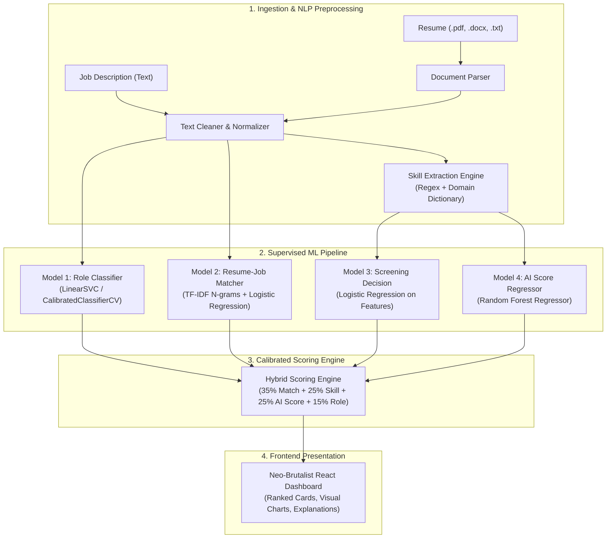

# ResumeScreenJi — AI/ML Resume Screening System

<p align="center">
  
</p>

<p align="center">
  <strong>An Explainable, Multi-Model Supervised Machine Learning Pipeline for Automated Resume Screening and Candidate Recommendation.</strong>
</p>

<p align="center">
  
  
  
  
  
  
</p>

---

## Overview

**ResumeScreenJi** is a full-stack automated resume screening and candidate ranking application designed for academic demonstration and production recruitment screening. 

Unlike black-box generative AI wrappers, ResumeScreenJi is built entirely on **classical, auditable, supervised machine learning (Scikit-learn)** and deterministic natural language processing. It parses candidate resumes (PDF, DOCX, TXT), extracts technical skills, performs multi-class role classification, predicts candidate-job matching probability, runs automated screening decisions, and synthesizes a calibrated hybrid match score.

---

## Academic & Presentation Highlights

This project includes three core features tailored for academic evaluation and live presentations:

### 1. Interactive "How the AI/ML Works" Explanation Panel
Accessible via the header button, this panel breaks down the system's inner workings:
- **7-Stage ML Pipeline**: From raw document ingestion and NLP tokenization to multi-model inference and hybrid score compilation.
- **4 Supervised ML Models**: Clear specifications of each model architecture, input vectorization, training strategy, and evaluation metrics.
- **Hybrid Scoring Formula**: Visual explanation of weighted scoring components ($35\%$ Match Probability + $25\%$ Skill Match + $25\%$ AI Screening Score + $15\%$ Role Confidence).
- **Candidate Fit Hierarchy**: Cutoffs for Strong Fit ($\ge 85$), Good Fit ($70\text{--}84$), Moderate Fit ($55\text{--}69$), and Weak Fit ($< 55$).
- **Deterministic AI Justification**: Formal academic rationale explaining why traditional Scikit-learn models are preferred over LLMs for hiring (auditable, zero hallucinations, consistent ranking, sub-50ms inference).

### 2. Structured ML Predictions & Results Card
Each screened candidate displays a rich, structured evaluation card:
- **4 Key Prediction Metrics**:
  - **Predicted Role**: Calibrated LinearSVC prediction with class confidence percentage.
  - **Job Match**: TF-IDF + Logistic Regression similarity score with decision recommendation.
  - **Screening Decision**: Logistic Regression acceptance classification with hire probability.
  - **Final Fit Level**: Color-coded badge based on the weighted hybrid formula.
- **Structured Skill Verification**: Distinct sections displaying matched skills with green checkmarks ($\checkmark$) and missing skills with amber alert indicators ($!$).
- **Explainable Score Breakdown**: Mathematical contribution breakdown showing exact weighted points contributed by each layer towards the final 100-point score.
- **Visual Analytics**: Interactive SVG Pie Chart (match vs. gap) and Skill Match Distribution Bar Chart.
- **Keyword-Highlighted Text Preview**: Collapsible resume excerpt highlighting matched keywords in context.

### 3. One-Click "Quick Fill Demo"
A dedicated button in the sidebar that instantly populates the screening form with a realistic, production-grade candidate (**Alex Chen — Senior ML Engineer**) and an industry-standard Job Description. Allows immediate end-to-end evaluation without manual file creation.

---

## Machine Learning Architecture



### Model Specifications

| Model Layer | Algorithm | Input Features | Target / Output | Evaluation Metric |
| :--- | :--- | :--- | :--- | :--- |
| **Role Classifier** | LinearSVC (Calibrated) | TF-IDF (1-2 ngrams, 10k max features) | 24+ Specialized Technical Roles | Test Accuracy: **71.43%**, Macro F1: **67.07%** |
| **Resume-Job Matcher** | Logistic Regression | TF-IDF Concatenated Resume + JD text | Match vs. Review Decision ($0 / 1$) | ROC-AUC: **73.31%**, Test F1: **67.41%** |
| **Screening Decision** | Logistic Regression | Skill overlap, Experience, Education | Accepted vs. Rejected Decision | Accuracy: **94.00%**, ROC-AUC: **99.85%** |
| **AI Score Regressor** | Random Forest Regressor | Structured Candidate Profile Attributes | Continuous Merit Score ($0\text{--}100$) | $R^2$: **96.56%**, MAE: **2.62** |

### Hybrid Scoring Formula

$$\text{Final Score} = 0.35 \times (\text{Match Prob} \times 100) + 0.25 \times (\text{Skill Match} \times 100) + 0.25 \times (\text{AI Score}) + 0.15 \times (\text{Role Conf} \times 100)$$

---

## Tech Stack

- **Backend**: Python 3.11, [FastAPI](https://fastapi.tiangolo.com/), Uvicorn, Pydantic
- **Machine Learning**: [Scikit-learn](https://scikit-learn.org/), NumPy, Pandas, Joblib
- **NLP & Document Parsing**: NLTK, PyPDF2, python-docx, Regular Expressions
- **Frontend**: [React 18](https://react.dev/), [Vite 5](https://vitejs.dev/)
- **Typography & Design**: Plus Jakarta Sans, Custom Curated SVGs, Neo-Brutalist Aesthetic (`#F7EBD9` background, `#FFF9EF` surfaces, 2px `#171717` dark borders, tactile offset box-shadows, light/dark theme toggle)

---

## Project Structure

```text
resume-screening-ml/
├── backend/
│   ├── .venv/                      # Dedicated Python virtual environment
│   ├── api/
│   │   └── routes.py               # FastAPI endpoint definitions
│   ├── services/
│   │   ├── recommender.py          # Hybrid ranking engine & scoring synthesis
│   │   ├── parser.py               # PDF, DOCX, and TXT extractors
│   │   ├── preprocessing.py        # Text tokenization, cleaning, and normalization
│   │   ├── skill_extractor.py      # Skill matching and gap analysis engine
│   │   ├── model.py                # LinearSVC role classifier training & inference
│   │   ├── matching_model.py       # TF-IDF resume-job matching model
│   │   ├── screening_model.py      # AI screening decision and regression models
│   │   ├── evaluation.py           # MAP and NDCG ranking metrics
│   │   └── data_preparation.py     # Data cleaning and pipeline prep
│   ├── main.py                     # FastAPI application entry point
│   └── requirements.txt            # Python dependencies
├── frontend/
│   ├── src/
│   │   ├── assets/
│   │   │   └── logo.png            # Application logo / mascot asset
│   │   ├── App.jsx                 # Main React dashboard & presentation components
│   │   ├── api.js                  # Frontend API client
│   │   ├── styles.css              # Custom Neo-Brutalist design tokens & responsive CSS
│   │   └── main.jsx                # React root mount
│   ├── public/
│   │   └── logo.png                # Static favicon & public asset
│   ├── index.html                  # HTML entry point with Google Fonts
│   ├── package.json                # Frontend dependencies & scripts
│   └── vite.config.js              # Vite configuration
├── models/                         # Serialized pre-trained .pkl model artifacts
│   ├── role_classifier.pkl
│   ├── label_encoder.pkl
│   ├── matching_tfidf_vectorizer.pkl
│   ├── matching_model.pkl
│   ├── screening_decision_model.pkl
│   ├── screening_score_model.pkl
│   ├── active_model.json
│   ├── active_matching_model.json
│   └── active_screening_model.json
├── data/
│   ├── raw/                        # Raw training source datasets
│   ├── processed/                  # Cleaned training CSVs
│   └── feedback/                   # Candidate feedback logs
├── outputs/                        # Exported CSV ranking outputs
├── logo.png                        # Primary brand illustrated mascot
├── DESIGN.md                       # Comprehensive design system documentation
├── run_backend.bat                 # One-click backend launcher (uses backend/.venv)
├── run_frontend.bat                # One-click Vite frontend launcher
└── run_all.bat                     # Launches both backend and frontend concurrently
```

---

## Getting Started

### Prerequisites
- **Python**: Version `3.10` or `3.11`
- **Node.js**: Version `18.x` or higher + `npm`

---

### Quick Launch (Windows)

Use the automated `.bat` scripts located in the project root:

```bash
# Option 1: Launch both Backend and Frontend concurrently
run_all.bat

# Option 2: Launch Backend only
run_backend.bat

# Option 3: Launch Frontend only
run_frontend.bat
```

---

### Manual Setup

#### 1. Backend Setup
```bash
# Navigate to backend directory
cd backend

# Create dedicated virtual environment
python -m venv .venv

# Activate virtual environment (Windows PowerShell)
.venv\Scripts\Activate.ps1
# Or on CMD:
.venv\Scripts\activate.bat

# Install dependencies
pip install -r requirements.txt

# Run FastAPI dev server
python -m uvicorn main:app --host 127.0.0.1 --port 8000 --reload
```

The FastAPI backend will be available at:
- **API URL**: `http://127.0.0.1:8000`
- **Interactive Swagger Documentation**: `http://127.0.0.1:8000/docs`
- **Health Check**: `http://127.0.0.1:8000/health`

#### 2. Frontend Setup
```bash
# In a separate terminal, navigate to frontend directory
cd frontend

# Install dependencies
npm install

# Start Vite dev server
npm run dev
```

The React frontend will be accessible at:
- **Dashboard URL**: `http://127.0.0.1:5173`

---

## API Endpoints Reference

| Method | Endpoint | Description |
| :--- | :--- | :--- |
| `GET` | `/health` | Backend and ML model health check |
| `POST` | `/api/recommend-upload` | Upload resume file (`.pdf`/`.docx`/`.txt`) with Job Description and return ranked ML results |
| `POST` | `/api/recommend` | Screen raw resume text against Job Description |
| `POST` | `/api/predict-role` | Predict technical role from resume text using LinearSVC |
| `POST` | `/api/predict-match` | Predict resume-to-job matching score and decision |
| `POST` | `/api/analyze-skills` | Extract matched, missing, and extra skills |
| `POST` | `/api/screen-candidate` | Predict candidate hire probability and AI score |
| `POST` | `/api/evaluate-ranking` | Calculate Mean Average Precision (MAP) and NDCG metrics |

---

## Deployment Guide

### Backend on Render
1. Create a **New Web Service** connected to the GitHub repository.
2. Configure settings:
   - **Root Directory**: `backend`
   - **Build Command**: `pip install -r requirements.txt`
   - **Start Command**: `uvicorn main:app --host 0.0.0.0 --port $PORT`
   - **Environment Variables**:
     - `PYTHON_VERSION`: `3.11.11`
     - `BACKEND_CORS_ORIGINS`: `https://your-frontend.vercel.app,http://127.0.0.1:5173`
3. Ensure model `.pkl` artifacts in `models/` are committed.

### Frontend on Vercel
1. Create a **New Project** importing the GitHub repository.
2. Configure settings:
   - **Framework Preset**: `Vite`
   - **Root Directory**: `frontend`
   - **Build Command**: `npm run build`
   - **Output Directory**: `dist`
   - **Environment Variables**:
     - `VITE_API_BASE`: `https://your-render-backend.onrender.com`

---

## Authors & Acknowledgments

- **Project**: ResumeScreenJi — AI/ML Resume Screening System
- **Technologies**: Scikit-Learn, FastAPI, React, Vite
- **Focus**: Transparent, deterministic, and explainable Machine Learning for automated recruitment.
